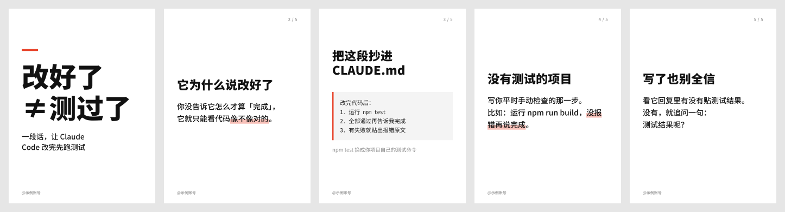

# 小红书 agent skill

给任何小红书图文账号用的一套 Claude / Codex skill，加一个 Go 写的本地工具 `xhs`。它把运营一个号的循环拆成可以交给 agent 的步骤：

```
找选题 → 写笔记 → 去 AI 腔 → 发布前检查 → 出卡片图 → 【你在 App 里发】
   ↑                                                        ↓
 规则 ← 实验 ← 复盘（和自己比，找漏斗哪一段掉了）← 按时记数据
```

美食、穿搭、理财、职场、健身、技术科普……领域不限。账号自己的定位、读者、信息源、目标都写在你本地的配置文件里，skill 本身不带任何账号的设定。

**什么都不会被自动发出去。** 这些 skill 只写、只读、只算。发布、回评论、回私信、改资料，都是你自己在 App 里做。



## 它是干什么的

运营一个小红书号，难的不是写一篇，是**持续地写对**：知道读者要什么、每篇都过得了平台规则、发完知道哪里出了问题、改了之后确认真的变好了。这套 skill 每一步各管一件事，靠 `$XHS_HOME` 里的文件串起来，所以可以手动一步步用，也可以交给定时任务或任意 agent 平台跑成一个 loop。

### 12 个 skill

| 阶段 | skill | 做什么 |
| --- | --- | --- |
| 研究 | `xhs-audience` | 读者是谁、在搜什么、在问什么、用什么词。产出带出处的 `audience.md`。 |
| | `xhs-viral` | 找对标：按「这篇赞藏 ÷ 该账号中位数」排低粉爆文，归到 18 个标题句式，写 `swipe.md`。 |
| 选题 | `xhs-topic` | 按 `sources.md` 扫信息源；每个候选写洞察句、过三问、按 `topic.json` 打分入选题池。 |
| | `xhs-repurpose` | 把一篇长文 / 论文 / 视频拆成几篇各自独立的笔记。 |
| | `xhs-plan` | 排一周：每篇写清「在测什么」，一篇只测一个变量。 |
| 写作 | `xhs-note` | 主流程：封面大字 + 3 个打过分的标题 + 正文 + 话题 + 卡片文案 + 置顶评论 → `post.json`。 |
| | `xhs-human` | 去 AI 腔：能安全改的自动改，套话和句式标出来你改，五项读者视角自检。 |
| | `xhs-check` | 发布前检查：先画出双列流里的样子，再查字数、导流、诱导、极限词、AI 声明和账号规则。 |
| | `xhs-cards` | 1080×1440 卡片，调本机 Chrome 出 PNG，检查溢出，拼预览图。 |
| 复盘 | `xhs-review` | 记数据、和自己的中位数比、分清问题在分发 / 封面标题 / 内容 / 主页 / 选题、开实验验证、结论写进 `playbook.md`；连续没起色时升级成深度诊断。 |
| | `xhs-profile` | 主页 11 项 100 分评分，按丢分排序重写。 |
| | `xhs-reply` | 整理评论和私信（含商务合作）：分八类，写短草稿由你改了亲手发，问题进选题池。 |

### 工具 `xhs`

只用 Go 标准库，不联网、不登录、不上传。所有命令都有 `--json` 输出。

```
写稿和把关   title  human  detect  check  cards
研究        words  swipe  eval
loop 状态   init  status  pool  log  data  goal  review  exp
```

## 怎么用

### 1. 安装

需要 Go 1.22+；出卡片图需要本机有 Chrome / Chromium / Edge。

```bash
git clone https://github.com/venciallee/xiaohongshu-agent-skill.git && cd xiaohongshu-agent-skill
(cd tool && go install .)                       # 装 xhs 到 $(go env GOPATH)/bin
cp -r skills/xhs-* ~/.claude/skills/            # Claude Code
cp -r skills/xhs-* ~/.codex/skills/             # Codex（可选）
```

或者在 Claude Code 里当插件装（`xhs` 仍然要按上面装一次）：

```
/plugin marketplace add venciallee/xiaohongshu-agent-skill
/plugin install xiaohongshu-agent
```

不想全局装 `xhs`：用仓库里的 `bin/xhs`，第一次运行会自动编译。

### 2. 建账号配置

```bash
xhs init          # 在 ~/.xiaohongshu 生成 voice.md / sources.md / goal.json / topic.json / house.json
```

| 文件 | 填什么 | 必填 |
| --- | --- | --- |
| `voice.md` | 写给谁、领域、选题类型、语气、节奏、不能碰的 | 是 |
| `sources.md` | 去哪找选题、读者在哪说话 | 是 |
| `goal.json` | 目标（比如 10 万粉）、多久复盘一次、「没起色」怎么算 | 是 |
| `topic.json` | 选题打分表和及格线 | 否，有默认 |
| `house.json` | 卡片张数、话题数、身份句、卡片配色字体、领域搜索词 | 否，有默认 |

不想手填 voice.md：把三篇你自己满意的旧笔记发给 Claude，说「照这些写我的 voice.md」。

有对应的领域包就启用它（目前有 `packs/ai-tech`）：

```bash
mkdir -p ~/.xiaohongshu/data && cp packs/ai-tech/titles.json ~/.xiaohongshu/data/
```

状态目录默认 `~/.xiaohongshu`，用 `XHS_HOME` 换。一个目录对应一个账号。

### 3. 写第一篇

直接对 Claude 说：

- 「分析一下我的读者」→ `xhs-audience`
- 「今天写什么」→ `xhs-topic`，给 3 个候选
- 「写候选 1」→ `xhs-note`，交付卡片图、3 个标题、正文、话题、置顶评论
- 你在 App 里发完，说「发了」→ 记进发布记录，并告诉你几时该记数据

### 4. 跑成 loop

```bash
xhs status        # 现在该做什么：记数据？复盘？写稿？深度诊断？
```

`xhs status --json` 是给编排器的入口：每次启动先跑它，按 `next` 往下做，不依赖对话记忆。两个定时任务（每天出稿 + 每 N 天复盘）就能把整个循环跑起来。完整的参考流程、闸门和 prompt 骨架见 [docs/loop.md](docs/loop.md)，状态文件格式见 [docs/contract.md](docs/contract.md)。

### 看看它输出什么

**`xhs status`**（一个模拟账号，发了两周）：

```
状态  ·  2026-11-26 11:30
  目标      668 / 10.0万，每天 +12.0，预计 2049-07-26
  已发      12 篇，今天 0 篇；草稿 0 篇
  复盘      上次 2026-11-26 11:24，连续没起色 4 / 3 次
  实验      0 个在跑；选题池 2 个候选

下一步
  1. capture_data        5 个数据点到时间了：n0@168h、n1@168h、n2@168h、n3@168h、n6@48h
  2. deep_diagnosis      连续 4 次复盘没起色（近期观看中位数 -1%，近期涨粉率 +0%，每天涨粉 +0%）。
                         别再逐篇小修：重做读者分析、重跑对标，只提一个原因一个实验
  3. start_experiment    没有在跑的实验：数据只在积累，没在验证任何东西
  4. write_today         今天还没有稿子；选题池里有 2 个候选
  5. refresh_audience    没有 audience.md：选题里的「有人搜」只能凭感觉
```

**`xhs exp show`**：一次只改一个变量，够篇数再读数，成立的写进 playbook：

```
实验 E1  ·  open
  假设      第2张就给可复制内容，收藏率能高过中位数
  实验组    5 篇已挂，5 篇可比，中位数 30.4%
  对照      6 篇（没挂实验的笔记），中位数 19.4%
  读数      支持假设：实验组收藏率中位数是对照的 1.57 倍，AUC 1.00。

$ xhs exp close E1 --result supported --rule "能复制的内容放第 2 张卡"
已追加到 playbook.md
```

**`xhs check`**：一篇刻意写坏的笔记（`examples/bad-post.json`）：

```
  双列流里大概长这样（示意）
  +------------------------+
  |   全网最全的AI编       |
  |   程保姆级教程合       |
  |   集                   |
  +------------------------+
    Anthropic发布Claude新
    功能！！程序员要失业了

  FAIL   标题 1         40 / 20 字，超了
  WARN   封面大字       16 字，超过 14，缩略图上读不完
  FAIL   导流           「评论扣 1 领资料」：评论区扣 1 领
  FAIL   诱导互动       「点赞过 100 就更新」：点赞过 100
  WARN   极限词         最强、最全、全网最、史上最
  WARN   标题党         震惊、程序员要失业
  WARN   第一人称经历   1 句「我试过 / 实测」类的话等账号主人确认
  FAIL   AI 声明        post.json 没有 ai_disclosure
  ...
  结论  FIX
```

**`xhs review`**：和本账号自己的中位数比，从漏斗前面往后找第一个掉下去的环节：

```
诊断（和本账号中位数比）
  一张图看懂MCP到底是什么
    - 主页：看的人多、关注的少。这篇没失败，是主页没接住，去 xhs-profile。
  为什么AI总说测过了？
    - 分发：曝光只有中位数的 22%。先看这篇有没有违规 / 限流提示，再看话题和标题里的搜索词。
按选题类型（倍数中位数）
  概念              3.4x  n=1
  为什么            0.2x  n=1
```

（示例数据都是编的，见 `examples/`。示例笔记是 AI 编程领域的，只是一个例子。）

## 为什么这样设计

**状态在文件里，不在对话里。** 定时任务每次启动都是新会话。发过什么、数据多少、哪个实验跑到第几篇，全在 `$XHS_HOME`，谁来跑都能接上。

**AI 是笔，不是人。** 小红书 2026-03-10 的《关于打击 AI 托管运营账号的治理公告》：偶发用 AI 代写代发或互动会被警告、限流；全流程托管、主页笔记全部由 AI 代发的直接封号。所以这里没有自动发布、自动评论、自动私信，也没有「每天去 10 个账号下评论」这种打法。回复只出草稿。

**去 AI 腔，不去 AI 标识。** 《人工智能生成合成内容标识办法》第十条禁止删除、隐匿 AI 标识；小红书 2026-02-12 的公告说未主动标识的 AI 内容会被加标并限制分发，2026-04-27 的规则要求 AI 生成或润色的内容主动声明。`xhs human` 只处理读者看得出来的模板感，不碰任何不可见字符和元数据；`xhs check` 把 AI 声明列为 FAIL 项。

**和自己比，不和攻略比。** 网上「点击率低于 5% 就是差」这类绝对线没有出处，领域之间差得很远。复盘和对标都用倍数：这篇 ÷ 这个账号的中位数。

**一次只改一个变量。** 复盘发现问题后，开一个实验，够篇数再读数；成立的写进 playbook，以后每篇都遵守。不成立也要记：「试过没用」防止下个月再试一遍。

**分清「题不行」和「包装不行」。** 同一类选题换了几种标题句式都起不来，问题在题本身。所以每篇都记选题类型，复盘按类型和句式分别分组。

结构参考了 [instagram-agent-skill](https://github.com/Jakeschincariol/instagram-agent-skill)（单一职责的 skill、共享账号档案、本地可运行的检查工具、人工发布闸门、不编造），但几乎每个 skill 都按小红书和中文重新想过：钩子在双列流的封面和标题而不是视频前两秒；别人的笔记看不到浏览量，所以用赞藏算倍数并看收藏/点赞比；中文不能用正则硬换词，所以大部分套话只标记；它的 `ig-comment`、`ig-dm`、`ig-story` 没有搬过来（前两者撞上平台对托管互动和导流的治理，后者没有对等形态），私信并进了 `xhs-reply`。

## 诚实的部分

- **标题打分没有在真实数据上验证过。** 用 `xhs eval` 拿你自己收的对标数据（≥40 条）检验它在你的领域能不能分开好坏；在 12 条编出来的示例数据上，它接近抛硬币。拿到证据之前，把它当成挡烂标题的工具。
- **五项 AI 腔自检、复盘诊断的阈值、「没起色」的定义都是启发式。** 阈值是拍的，写在代码和 goal.json 里，可以改。
- **平台规则会变。** `platform.json` 写了核实日期和出处。和 App 当下提示冲突时，App 是对的，改文件。导流和极限词清单不完整：命中不一定违规，没命中不代表安全。
- **不编造。** 不编数字、经历、出处；缺一个数字草稿里就留 `{{你的数字}}`。「我试过」这类句子没你点头不会出现在定稿里。

## 怎么优化和贡献

最好的贡献是用它跑一段时间，把被数据验证过的东西带回来：

- **验证标题打分**：`xhs eval` 的 AUC 结果、领域、样本量，开 issue 贴出来。
- **playbook 里的规则**：你用实验验证过、觉得不只对你成立的，贴出规则和证据，跨账号重复出现的会变成默认做法。
- **领域包**：把 `titles.json` 的示例和读者口头语换成你的领域，放进 `packs/<领域>/`。
- **平台规则更新**：改 `platform.json`，附出处，更新核实日期。

改哪一层、代码约定、测试要求见 [CONTRIBUTING.md](CONTRIBUTING.md)。一条硬规矩：自动发布、自动评论、自动私信、批量抓取的 PR 不会合并。

## 文件

```
skills/xhs-*/SKILL.md          12 个 skill（每个开头都有「读 / 写」表）
skills/xhs-profile/rubric.json 主页 100 分评分表
tool/                          xhs 的 Go 源码（标准库，无依赖）和测试
tool/data/                     内置数据：去 AI 腔词库、18 个标题句式、平台规则、配置模板
packs/<领域>/                  领域包
docs/contract.md               状态文件格式、命令约定、xhs status 的动作表
docs/loop.md                   参考 loop：定时任务、闸门、prompt 骨架
examples/                      示例笔记、坏笔记、对标和复盘的示例表
bin/xhs                        启动器：第一次运行自动编译
```

## License

MIT。结构参考 instagram-agent-skill（MIT），见 `NOTICE`。
